# OpenAPI — data model, plain

Status: **implemented**; diagram refreshed to the code on 2026-10-29
([../notes/2026-10-architecture-review.md](../notes/2026-10-architecture-review.md), D1). Decisions
behind this shape: I1, I5 in [../notes/2026-10-implementation-decisions.md](../notes/2026-10-implementation-decisions.md).
Paths are relative to `packages/next-data-model/src/`. Abstract layer:
[../../shared/architecture/data-model-plain.md](../../shared/architecture/data-model-plain.md).

```mermaid
flowchart TB
  subgraph ABS["Abstract (shared)"]
    TreeBuilderAbs["TreeBuilder"]
    NodeDataBuilderAbs["AbstractNodeDataBuilder"]
    HooksAbs["createTreeBuildingHooks"]
    NodesAbs["SimpleTreeNode (every OpenAPI node is simple, I1)"]
  end

  subgraph SEC["Security module (spec-neutral, shared with AsyncAPI)"]
    SecSpec["building-service/security/<br/>SecuritySpec · SecuritySpecBuilder&lt;TInput&gt; · getSecurityCrawlRules"]
    SecModel["model/security/<br/>SecurityTreeNodeKinds · SecurityTreeNodeValue ·<br/>SecurityDisplayLabels · SecurityNodeVisibility · SecurityPresentation"]
  end

  subgraph SHARED["shared/openapi"]
    Keys["types/operation-keys.ts · OpenApiOperationKeys"]
    Params["types/tree-builder-params.ts"]
    Codes["types/response-code.ts<br/>OpenApiResponseCodeClasses · OpenApiResponseCode (resolveClass · compare · sort)"]
    Methods["types/http-method.ts · OpenApiHttpMethods · OPEN_API_HTTP_METHODS_ORDER"]
    Guards["guards/tree-node.ts · isOpenApiTreeNodeWithDiffs"]
  end

  subgraph MODEL["model/openapi"]
    Kinds["types/node-kind.ts<br/>operation · ...SecurityTreeNodeKinds · extensions · request · parameters ·<br/>requestBody · content · mediaType · responses · response · responseHeaders"]
    Values["types/node-value.ts · node-meta.ts · aliases.ts"]
    TreeImpl["tree/tree.impl.ts · OpenApiTree"]
    Labels["display/labels.ts · OpenApiDisplayLabels"]
    SecPres["security-presentation.ts<br/>OpenApiSecurityDisplayLabels · OpenApiSecurityNodeVisibility ·<br/>OPENAPI_SECURITY_PRESENTATION"]
    Visibility["node-visibility.ts · OpenApiNodeVisibility (I5)"]
    Layout["layout/ · OpenApiBlockEdges (extends abstract BlockEdges) ·<br/>OpenApiLayoutLevel · OpenApiSpacingConfig"]
  end

  subgraph BS["building-service/openapi"]
    Dialects["shared/dialects/<br/>OpenApiDialectResolver → OpenApi30Dialect | OpenApi31Dialect"]
    Transformer["shared/openapi-spec-transformer.ts · OpenApiSpecTransformer<br/>resolveOperation · buildSpec · buildRequest · buildContent ·<br/>cloneExtensionsIntoSchema · buildResponses · copyExtensions"]
    SecBuilder["shared/openapi-security-spec-builder.ts · OpenApiSecuritySpecBuilder"]
    Synth["shared/object-schema-synthesizer.ts · OpenApiObjectSchemaSynthesizer"]
    Builder["tree/builder.ts · OpenApiTreeBuilder<br/>sortResponseCodes after the crawl"]
    Hooks["tree/building-hooks.ts · createOpenApiTreeBuildingHooks"]
    Rules["json-crawl-entities/rules/rules.ts · getOpenApiCrawlRules(kind)"]
    CrawlTx["json-crawl-entities/transformers/collect-raw-values.ts"]
    NodeData["tree/node-data/builder.ts · OpenApiNodeDataBuilder · OPENAPI_NODE_VALUE_PROPS"]
  end

  TreeBuilderAbs -->|extends| Builder
  NodeDataBuilderAbs -->|extends| NodeData
  SecSpec -->|extends| SecBuilder
  Builder --> Params
  Params --> Keys
  Builder --> Transformer
  Transformer --> Dialects
  Transformer --> SecBuilder
  Transformer --> Synth
  Transformer --> Codes
  Transformer --> Methods
  Builder --> Hooks
  Hooks --> HooksAbs
  Builder --> Rules
  Rules --> SecSpec
  Rules --> CrawlTx
  Rules --> Kinds
  Kinds --> SecModel
  Builder --> NodeData
  NodeData --> Values
  Builder --> TreeImpl
  Builder --> Codes
  TreeImpl --> NodesAbs
  SecPres --> SecModel
  Visibility --> Values
  Labels --> Values
  Layout --> Visibility
  Guards --> Values
```



## Operation-oriented spec

Output of `OpenApiSpecTransformer.transform(source, operationKeys)`; input of the crawl. Every
field below `data` maps to one node kind through the crawl rules.

```typescript
export interface OpenApiOperationOrientedSpec {
  id: string                                   // `${METHOD} ${path}`
  path: string
  method: OpenApiHttpMethod
  specVersion: OpenApiSpecVersion
  title?: string                               // summary
  operationId?: string
  description?: string
  externalDocs?: OpenApiExternalDocs
  deprecated?: boolean
  data: {
    security?: SecuritySpec                    // spec-neutral, building-service/security/security-spec.ts
    extensions?: Record<SpecificationExtensionKey, unknown>
    request?: {
      parameters?: Partial<Record<OpenApiParameterLocation, { location; schema: OpenApiSynthesizedObjectSchema }>>
      requestBody?: { description?: string; required?: boolean; content?: Record<string, { mediaType: string; schema?: unknown }> }
    }
    responses?: Record<string, {               // re-sorted on the tree (sortResponseCodes)
      code: string
      codeClass: OpenApiResponseCodeClass
      description?: string
      headers?: { schema: OpenApiSynthesizedObjectSchema }
      extensions?: Record<SpecificationExtensionKey, unknown>   // Response Object x-*
      content?: Record<string, { mediaType: string; schema?: unknown }>   // media-type and (request: body-level) x-* already cloned into schema roots
    }>
    responsesExtensions?: Record<SpecificationExtensionKey, unknown>   // Responses Object x-*; OUTSIDE `responses`
  }
}
```

Empty containers are omitted (no `request` without parameters and body, no `headers` without
entries, no media type without `schema`) so visibility can rely on presence.

## Crawl rules

`getOpenApiCrawlRules(kind)`; every node is **simple** (I1):

```typescript
{
  '/data': {
    '/security': getSecurityCrawlRules(),      // /alternatives/* → /schemes/* → /flows/*
    '/extensions': { kind: EXTENSIONS, transformers: [collectOpenApiRawValues] },
    '/request': {
      '/parameters': { '/*': { kind: PARAMETERS } },
      '/requestBody': { '/content': { '/*': { kind: MEDIA_TYPE }, kind: CONTENT }, kind: REQUEST_BODY },
      kind: REQUEST,
    },
    '/responses': {
      '/*': {
        '/headers': { kind: RESPONSE_HEADERS },
        '/extensions': { kind: EXTENSIONS, transformers: [collectOpenApiRawValues] },
        '/content': { '/*': { kind: MEDIA_TYPE }, kind: CONTENT },
        kind: RESPONSE,
      },
      kind: RESPONSES,
    },
    '/responsesExtensions': { kind: EXTENSIONS, transformers: [collectOpenApiRawValues] },
  },
  kind,
}
```

Notes:

- Intermediate segments without `kind` (`/data`, `/alternatives`, `/schemes`, `/flows`,
  `/parameters`) only route the crawl: `createTreeBuildingHooks` returns without creating a node
  when `rules.kind` is missing and keeps crawling.
- Selector options (alternatives, schemes, media types, response codes) are ordinary children; the
  viewer picks them by kind guard (`getOpenApiChildren`). The Responses Object's extensions live in
  `data.responsesExtensions`, a sibling of `data.responses`, so every child of `responses` is a
  response-code option.
- Leaf kinds (`parameters`, `responseHeaders`, `mediaType`, `extensions`, `oauthFlow`) declare no
  sub-rules: schemas and raw values stay on the node value and are rendered by nested viewers.
- JS enumerates integer-like keys first, so the canonical response-code order is applied to the
  tree children after the crawl (`OpenApiTreeBuilder.sortResponseCodes`).
- Lazy materialization: not used (eager build); nested schemas are not crawled by this builder.

## Notes

- Node value pick lists: `OPENAPI_NODE_VALUE_PROPS` (`tree/node-data/builder.ts`, `satisfies` per
  kind); the security kinds reuse `SECURITY_NODE_VALUE_PROPS`. The same lists are the field-diff
  allow-list of the with-diffs aggregators.
- `meta`: `{ _fragment, unresolvedSecurityScheme? }`.
- Row visibility: `OpenApiNodeVisibility` (operation header rows, body / response descriptions) and
  `OPENAPI_SECURITY_NODE_VISIBILITY` (scheme cards, flows). Pure functions of a node value, valid for
  plain and merged trees (I5).
- Layout data (separator rows, card frame rows, block edges): the spec-neutral planner, types,
  shared config and generic edges in `model/abstract/layout/` (also used by the AsyncAPI Security
  section; security edges in `model/security/block-edges.ts`), the OpenAPI levels, config and edges in
  `model/openapi/layout/`; design
  [../features/vertical-gaps.md](../features/vertical-gaps.md), [../features/block-separators.md](../features/block-separators.md).
- Exports: `OpenApiTreeBuilder`, `OpenApiTreeWithDiffsBuilder`, `createOpenApiLogger`, the builder
  params and `OpenApiOperationKeys` from the package root `src/index.ts`.
