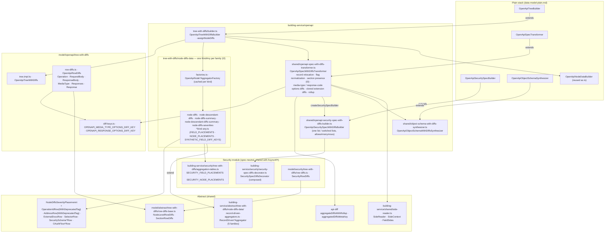

# OpenAPI — data model, with diffs

Status: **implemented**; diagram refreshed to the code on 2026-10-29
([../notes/2026-10-architecture-review.md](../notes/2026-10-architecture-review.md), D1). Decisions
behind this shape: I2, I3, I6–I8 in [../notes/2026-10-implementation-decisions.md](../notes/2026-10-implementation-decisions.md).
Paths are relative to `packages/next-data-model/src/`. Abstract layer:
[../../shared/architecture/data-model-with-diffs.md](../../shared/architecture/data-model-with-diffs.md).
Rules: [../features/diffs.md](../features/diffs.md).

## Builder contract

`OpenApiTreeWithDiffsBuilder` overrides only:

| Member | Rule |
| --- | --- |
| `public declare readonly tree: OpenApiTreeWithDiffs` | retype only |
| `createTree()`, `createNodeDataBuilder()`, `prepareSource()`, `logPrefix` (`[OpenAPI][WithDiffs]`) | overrides |
| `takeCrawlValue()` | keeps arrays (`isObjective`) — list records (alternatives) live on the arrays |
| `createNodeFromRaw()` | `super.createNodeFromRaw(...)`, narrow with `isOpenApiTreeNodeWithDiffs`, then `assignNodeDiffs` |
| `assignNodeDiffs()` | node diffs → summary → descendant diffs → descendant summary (from the rollup; `mergeAggregatedDiffTypesIntoDescendantSummary` is **not** called, I6) → severities |

No type assertions between plain and with-diffs node types; guards only.

## Notes

- The transformer writes every diff where its row reads it (child-section, option, scheme, and
  synthetic whole-section records); the aggregators only map records to rows through the kind
  tables — no per-kind aggregator classes (I2).
- Section presence per side is computed inside the transformer (a `WeakMap` from each built
  section to its presence, `writeSectionDiff`), not by a separate resolver (I3).
- Parameters, response headers, media-type schemas, and extensions are separate trees in the
  viewer; the forward descendant summary reads `aggregatedDiffsMetaKey`, so changes inside those
  trees still mark selector options and section headers.
- Section headers follow
  [../../shared/features/section-header-colorizing.md](../../shared/features/section-header-colorizing.md)
  evaluated over section presence per side, [../features/diffs.md](../features/diffs.md#section-presence-and-whole-section-changes).
- Row visibility has no with-diffs variant: `OpenApiNodeVisibility` works on merged values (I5).
