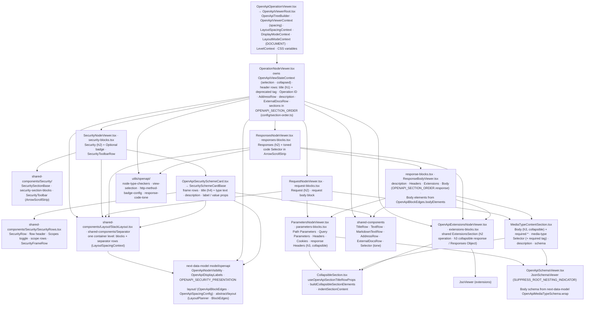

# OpenAPI — viewer, plain

Status: **implemented**; diagram refreshed to the code on 2026-10-29
([../notes/2026-10-architecture-review.md](../notes/2026-10-architecture-review.md), D1). Decisions
behind this shape: V1–V11 in [../notes/2026-10-implementation-decisions.md](../notes/2026-10-implementation-decisions.md).
Paths are relative to `packages/api-doc-viewer/src/components/OpenApiOperationViewer/`. Abstract
layer: [../../shared/architecture/viewer-plain.md](../../shared/architecture/viewer-plain.md). Row
stack: [../features/operation-viewer.md](../features/operation-viewer.md#row-stack).

## Notes

- Containers are `build*Block` functions (in `*-blocks.tsx` modules) plus row components (in the
  component files): a block carries its edges (from
  `OpenApiBlockEdges`) and a `payload` render function; `StackLayout` plans the separators of one
  level and renders the payloads.
- Containers read node values, visibility flags, and display labels from next-data-model; they
  compute neither visibility nor labels.
- Child lists go through guard helpers (`utils/openapi/node-type-checkers.ts`), never
  `childrenNodes() as …`.
- All hooks run before any early `return` (outer component returns `null` for a missing source,
  inner component checks the root kind after its hooks).
- The security card, toolbar, rows and `StackLayout` are also used by the AsyncAPI security
  sections (review finding F1: still under OpenAPI names).
