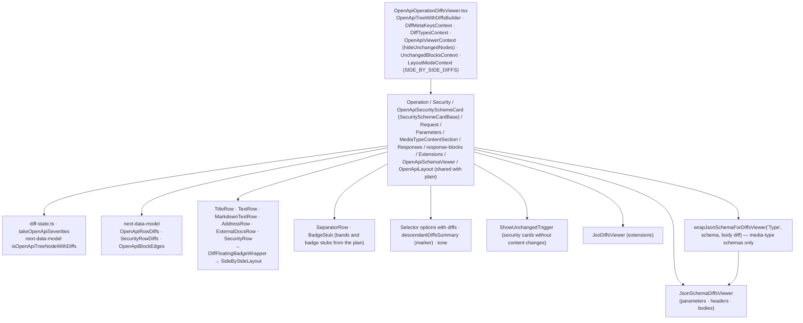

# OpenAPI — viewer, with diffs

Status: **implemented**; diagram refreshed to the code on 2026-10-29
([../notes/2026-10-architecture-review.md](../notes/2026-10-architecture-review.md), D1). Paths are
relative to `packages/api-doc-viewer/src/components/OpenApiOperationViewer/`. Abstract layer:
[../../shared/architecture/viewer-with-diffs.md](../../shared/architecture/viewer-with-diffs.md).
Rules: [../features/diffs.md](../features/diffs.md).

The OpenAPI layer has **no separate with-diffs containers** (D5): the plain containers
([viewer-plain.md](viewer-plain.md)) read diff props from `OpenApiRowDiffs` / `SecurityRowDiffs`
and severities through `takeOpenApiSeverities`, which are empty on a plain tree. Only the root,
the providers, and the nested viewers differ.

## Notes

- Parameter groups and response headers go to `JsonSchemaDiffsViewer` **unwrapped**: the
  synthesizer already attached property-level diffs. Media-type schemas are wrapped under `Type` in
  the viewer (review finding F5 proposes moving that wrapper into the transformer).
- Every row passes its own `diffsSeverityPlacement`; no two rows of one node share a placement.
- Rows whose content div plugs into `SideBySideLayout` carry `flex w-full` (width contract). Verify
  row-background width with `getBoundingClientRect()` in the IT or Storybook — pale diff
  backgrounds are invisible to pixelmatch (testing skill, pixel-diff blind spot).
- `JsoDiffsViewer` installs its own contexts; OpenAPI-level `diffTypes` do not reach extensions
  (same as AsyncAPI).
